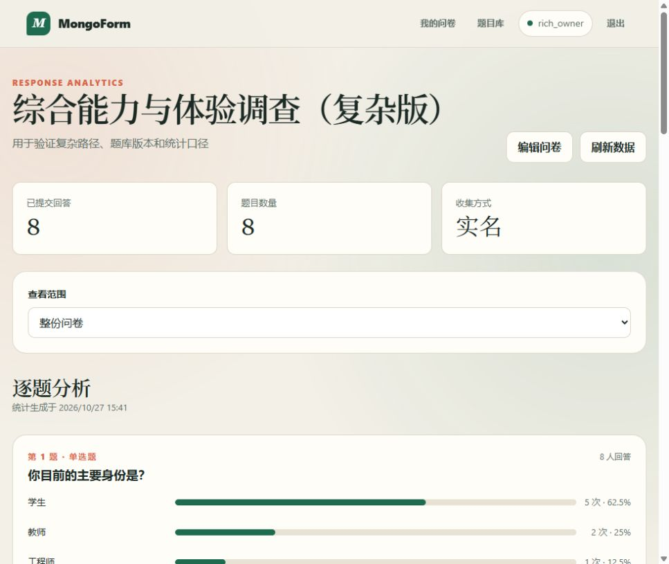
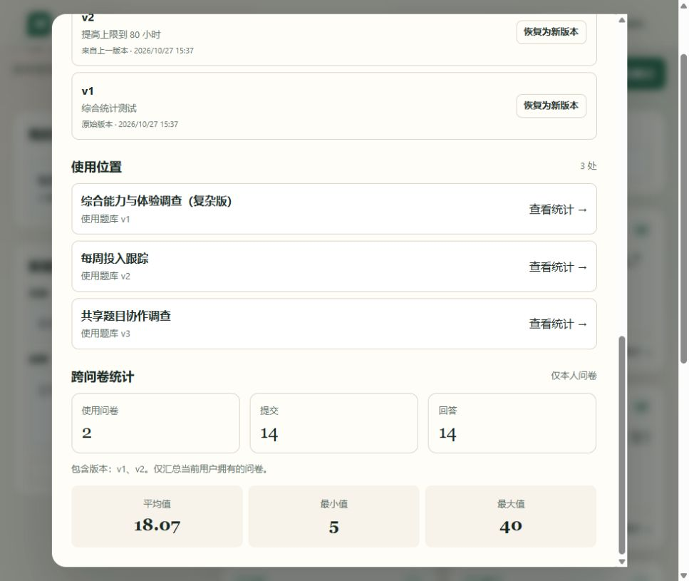

# 在线问卷系统第二阶段项目完成报告

仓库：https://github.com/Day0God/DataBase/tree/homework01

## 摘要

本项目第一阶段完成了一个使用 Flask、PyMongo 和 MongoDB 的在线问卷系统，覆盖账号、问卷状态、四类题型、条件跳转、答案校验、匿名与重复控制以及聚合统计。第二阶段根据新增需求，在不替换原系统的前提下加入题库、题目共享、不可变版本、使用关系查询和单题跨问卷统计。

本阶段的核心设计变化是：题库保存逻辑题目和不可变版本，问卷继续保存加入时的完整题目快照。题库修改只会产生新版本，不会改变已有问卷、历史回答和统计含义。最终自动测试共 17 项，全部通过；另完成 26 个基础浏览器步骤和 12 个复杂统计场景，包括 8 题问卷、重复填写、三条跳转、三个题库版本和 14 份跨问卷回答。复杂测试还发现并修复了“题库题目带跳转时来源关系丢失”的缺陷。

## 项目目标

### 第一阶段目标

- 注册用户可以创建、发布、关闭和管理自己的问卷。
- 支持单选、多选、文本和数字四种题型。
- 支持基于单选、多选和数字答案的条件跳转。
- 浏览器端即时校验，服务端重新计算路径并最终判定。
- 支持匿名填写、每人一次、允许重复填写和幂等提交。
- 使用 MongoDB 保存用户、会话、问卷、题目和回答。
- 创建者可以查看整卷和逐题统计。

### 第二阶段目标

- 创建命名题库并保存常用题目。
- 将题目共享给其他账号，供其在本人问卷中使用。
- 修改题目时生成新版本，保留历史版本与父子关系。
- 从历史版本恢复时生成新的后继版本。
- 不同问卷可使用同一逻辑题目的不同版本。
- 查看一个题目被哪些问卷使用。
- 对当前用户多份问卷中的同一题目做统一统计。
- 保留第一阶段全部核心功能，不允许推倒重做。

## 第一阶段的设计

### 分层结构

第一阶段采用浏览器、Flask API、业务逻辑和 MongoDB 数据层四层结构。浏览器负责页面和即时提示；Flask 负责认证、权限和流程控制；业务层负责题目归一化、答案校验、跳转遍历和幂等；MongoDB 负责持久化、约束、索引和聚合。

| 层次 | 第一阶段职责 |
| --- | --- |
| 浏览器 | 登录、编辑器、一次一题填写、整卷统计 |
| HTTP API | 认证、所有权检查、状态转换、统一错误响应 |
| 业务逻辑 | 题型校验、路径遍历、重复提交和统计口径 |
| 数据层 | 五集合、JSON Schema、唯一索引、TTL 和聚合 |

### 第一阶段数据模型

| 集合 | 设计职责 |
| --- | --- |
| `users` | 用户名、标准化键、密码哈希和注册时间 |
| `sessions` | 令牌哈希、用户、创建时间和 TTL 过期时间 |
| `surveys` | 所有者、标题、状态、slug、匿名和重复策略 |
| `questions` | 问卷内题目快照、选项、校验和跳转 |
| `submissions` | 一次完整提交、答案数组、匿名和幂等键 |

题目与问卷分离，是因为题目有独立顺序、保存和查询需求；选项、校验和跳转嵌入题目，是因为它们与单题生命周期一致。答案数组嵌入一次提交，是因为一次填写必须作为整体写入。

### 第一阶段跳转设计

跳转条件完全由数据驱动：

- 单选：`option_is + optionId`
- 多选：`contains + optionId`
- 数字：`eq/neq/gt/gte/lt/lte/between + value`

服务端从第一题重新遍历。命中当前题目第一条规则时进入目标题目，否则进入下一题。目标必须位于当前题目之后，因此不会形成无限循环。被跳过的必答题不要求回答，未到达题目的额外答案会被拒绝。

### 第一阶段校验设计

浏览器校验用于即时反馈，服务端校验是最终依据。必答、多选数量、文本长度、数字范围、整数限制、选项归属和答案类型均在服务端重新执行。MongoDB `$jsonSchema`、唯一索引和 TTL 索引构成数据库层保护。

## 新需求带来的问题与设计修改

### 新需求清单

新增需求 DOCX 提出八项要求：

1. 保存常用题目并在新问卷中复用。
2. 将题目共享给其他用户。
3. 修改题目不能影响已发布问卷。
4. 记录题目修改历史和恢复旧版本。
5. 同一题目的不同版本同时存在。
6. 查询题目被哪些问卷使用。
7. 建立可管理、可从其中选题的题库。
8. 查看同一题目跨问卷的回答统计。

### 新需求带来的问题

| 问题 | 第一阶段设计为何不足 |
| --- | --- |
| 题目只能属于单份问卷 | 第一阶段 `questions` 以 `surveyId` 绑定问卷，没有稳定题目身份 |
| 重复创建成本高 | 没有题库、共享和逻辑题目层 |
| 题库更新可能改变旧卷 | 如果改为实时引用同一个题目对象，old survey 将失去历史含义 |
| 无法追溯来源 | 问卷题目只保存问卷内 ID，没有题库题目和版本 ID |
| 无法比较历史版本 | 没有不可变版本、父版本和恢复来源 |
| 无法做跨问卷统计 | 统计只接受一个 `surveyId` |
| 共享可能扩大数据权限 | 题目使用权限与回答查看权限尚未分离 |

### 为什么需要修改原设计

第一阶段将题目当作问卷内部快照，适合单一问卷，但不能表达多个问卷复用同一个题目。直接让问卷实时引用一个可变题目，会让题库编辑改变旧问卷和已有回答的含义；直接复制题目又会失去版本和使用关系。

因此需要增加“逻辑题目、不可变版本、问卷快照”三层关系。题库负责复用和版本管理，问卷仍保留自己的完整快照，从而同时满足复用和历史稳定性。

### 修改了哪些部分

| 部分 | 修改 |
| --- | --- |
| 数据库 | 新增题库、逻辑题目、题目版本三个集合 |
| 问卷题目 | 增加可选题库题目 ID、版本 ID、版本号和所有者 ID |
| API | 新增题库、共享、版本、恢复、使用关系和跨问卷统计接口 |
| 业务逻辑 | 复用原题目校验，增加版本不可变、题库访问权与来源一致性检查 |
| 编辑器 | 增加“从题库添加”和版本选择 |
| 页面 | 新增 `/library` 题库管理页 |
| 测试 | 新增共享、版本、快照隔离、跳转兼容和跨问卷统计测试 |

### 数据结构如何变化

第一阶段五个集合保持原职责。第二阶段新增：

- `question_banks`：保存题库名称、所有者和管理信息。
- `library_questions`：保存稳定逻辑题目身份、所有者、当前版本和共享用户。
- `library_question_versions`：保存不可变题目快照、版本号、父版本和恢复来源。

`questions.libraryQuestionId` 和 `questions.libraryVersionId` 只作为来源追踪信息。问卷仍同时保存题目全文、选项和校验，所以旧问卷不依赖当前题库内容。

### 程序如何调整

1. 编辑器加载可访问题库，用户选择逻辑题目和具体版本。
2. 前端复制版本快照，生成问卷内新的题目 ID。
3. 保存问卷时服务端确认版本属于该逻辑题目，且快照内容一致。
4. 问卷可以在快照基础上继续配置自己的跳转。
5. 修改题库时追加新版本，并将逻辑题目当前版本指针更新到新版本。
6. 恢复历史版本时复制历史快照生成新版本，而不是覆盖当前版本。
7. 跨问卷统计先查当前用户拥有的问卷，再汇总引用同一逻辑题目的答案。

### 是否遇到兼容性问题

第一阶段数据库不需要删除或重建。新字段全部为可选，旧题目文档可以继续读取、填写和统计。应用启动时通过 `collMod` 幂等增加集合校验器，并为新集合创建索引。

复杂测试发现一项实际兼容缺陷：题库题目加入问卷并配置跳转后，来源字段会被误清除，导致跨问卷统计漏掉整份综合问卷。修复方式是只比较题库版本快照的标题、题型、选项、必答状态和校验，不把问卷自己的跳转视为快照变化。

### 如何保证旧功能仍然可用

- 原有问卷、认证、填写和统计 API 未删除。
- `questions` 仍保存问卷实际使用的完整快照。
- 原有跳转解释器和答案校验函数继续执行。
- 发布中禁止改题，已有回答后锁定题目的规则保持不变。
- 第一阶段 13 项测试全部保留，并在第二阶段每次修改后回归。
- 旧问卷没有题库来源字段时仍按普通题目处理。

## 系统设计

### 总体架构

第二阶段继续使用 Python、Flask、PyMongo、MongoDB 和原生前端，新增题库 API 与页面，不引入新的关系数据库或前端框架。

### 版本与快照

```text
v1 创建
  │ parentVersionId
  ▼
v2 修改
  │ parentVersionId
  ▼
v3 恢复自 v1
  ├─ parentVersionId = v2
  └─ restoredFromVersionId = v1
```

同一逻辑题目保持稳定 `_id`，版本文档不可变，历史版本同时保留。同一版本族不能改变题型，避免跨版本统计不可比。

### 共享与权限

所有者可以创建版本、恢复版本、共享题目和查看使用位置。被共享用户可以查看版本并把任一可访问版本加入自己的问卷，但不能修改所有者题目。

跨问卷统计只汇总当前用户自己拥有的问卷；“使用位置”允许所有者看到其他用户的共享使用，但不暴露其他用户的回答。

### 题库题目进入问卷

题库不保存跨题跳转，因为跳转目标 ID 属于具体问卷。加入题库题目后，该题目成为问卷快照，可独立配置后续跳转。题库版本校验只比较题目自身内容，问卷内跳转不参与版本一致性比较。

## AI 使用过程

### AI 使用日志

使用工具：OpenAI Codex 桌面编程代理、终端执行、文件编辑、Computer Use 浏览器控制、Python 3.13、Flask 3.1、PyMongo 4.18、MongoDB 8.3、unittest、Node.js 语法检查。

| 编号 | 真实提示或提示摘要 | 得到的代码或设计 | 是否修改 | 修改内容 |
| --- | --- | --- | --- | --- |
| AI-01 | 开发类似问卷星的系统，必须使用 MongoDB，不允许关系数据库和现成问卷框架 | Flask API、五个集合、四类页面和测试目录 | 是 | 放弃无法安装依赖的 Node 草稿，改为 Flask + PyMongo |
| AI-02 | 勿把所有数据放一个集合，说明冗余和 MongoDB 适用性 | Schema、索引、TTL、HMAC 去重和幂等设计 | 是 | 题目与选项边界、匿名去重和唯一索引多次调整 |
| AI-03 | 根据单选、多选和数字答案动态跳转 | 数据驱动条件结构和通用遍历器 | 是 | 限制只能向后跳，拒绝未到达题目的答案 |
| AI-04 | 完成前后端、发布链接、匿名和统计 | 原生前端四个页面和动态表单 | 是 | 修复预览链接、题目顺序 `NaN` 和默认必答 |
| AI-05 | 注册时间不可查看、跳转显示 NaN、关闭问卷后不能重新发布 | 注册时间展示、CLI 查询、重开流程和回归测试 | 是 | 设置与题目分开保存，已有回答时只锁定题目 |
| AI-06 | 启动 MongoDB 和系统并运行测试 | 启动、健康检查和测试流程 | 否 | 验证现有代码，不修改业务逻辑 |
| AI-07 | 编写完整文档和报告，补充 AI 使用日志与说明 | 系统、数据库、API、逻辑、测试和报告文档 | 是 | 测试从 12 项修正为当时真实的 13 项 |
| AI-08 | 根据新增需求 DOCX 扩展系统，不得推倒重做 | 题库、版本、共享、使用关系和跨问卷统计 | 是 | 保留题目快照，新增三个集合和 `/library` 页面 |
| AI-09 | 题目太少，要求复杂问卷、重复填写和可观察统计 | 8 题复杂测试数据、多路径回答和截图证据 | 是 | 发现并修复题库题目带跳转时来源丢失的问题 |

完整逐项日志及原始 Prompt 节选见附录 A，未把模型内部推理或未执行结果写入日志。

### AI 使用说明

AI 帮助完成了需求拆解、MongoDB 模型、Flask API、原生前端、版本逻辑、自动化测试、复杂测试数据和文档初稿。AI 还根据实际测试输出定位兼容问题。

AI 做错或遗漏的部分：

- 最初选择当前环境无法安装依赖的 Node.js 方案。
- 新题顺序未同步，跳转目标曾显示 `第NaN题`。
- 关闭已有回答问卷时无条件保存题目，被历史回答保护阻断。
- 预览链接曾指向 `#`。
- 两项测试最初误判实际路径。
- 题库题目加入跳转后，来源字段曾被错误清除。

本人在项目中完成的人工工作：

- 提供第一阶段和第二阶段需求，指出必须保留旧功能。
- 实际验收注册时间、跳转目标、关闭后重开、默认必答等交互。
- 要求使用更复杂的问卷、题库和统计场景，并开启重复填写。
- 要求测试用例必须包含测试步骤、输入、输出和结果。
- 审核 AI 产出，推动真实测试和缺陷修复，而不是直接提交生成结果。

本人参与确定并验收的设计约束：

- 不替换第一阶段系统，必须增量扩展。
- 题库改版不能改变已发布问卷和历史答案。
- 版本修改采用追加方式，恢复历史也必须保留版本链。
- 测试必须覆盖不同跳转路径、重复回答和跨问卷统计。
- 共享题目的使用权限不能自动等同于查看其他用户回答的权限。

本人设计并落实的验收方案：

- 将测试分为基础功能自动化、基础浏览器验收和复杂统计验收三层。
- 使用 8 题问卷构造学生、教师、工程师三条路径，并以重复提交检验统计累积。
- 用同一题库题目的 v1、v2、v3 分别对应不同问卷，检查旧快照和跨版本统计。
- 要求每项测试都保留测试步骤、输入、输出和结果，并保存浏览器截图。

底层集合结构、版本模型和接口实现主要由 AI 提出并经本人测试后采用；本人没有把这些 AI 设计表述为独立编写。

代码主体由 AI 辅助生成，本报告不将 AI 初稿描述为人工独立编写，也不将未运行的测试写成通过。

## MongoDB 设计

### 集合与聚合边界

| 集合 | 主要字段 | 设计原因 |
| --- | --- | --- |
| `users` | `usernameKey`、`passwordHash`、`createdAt` | 唯一账号和安全密码 |
| `sessions` | `tokenHash`、`expiresAt` | 服务端会话和 TTL |
| `surveys` | `ownerId`、`slug`、`status` | 问卷元数据和生命周期 |
| `questions` | `surveyId`、题目快照、来源版本 | 问卷实际内容与历史稳定性 |
| `submissions` | `answers[]`、参与者键、幂等键 | 一次回答作为完整业务边界 |
| `question_banks` | `ownerId`、`nameKey` | 命名题库管理 |
| `library_questions` | `currentVersionId`、`sharedWith` | 逻辑题目、当前版本与共享 |
| `library_question_versions` | `snapshot`、`parentVersionId` | 不可变历史与版本谱系 |

### 关键索引

- 用户名、slug、会话令牌保持唯一索引。
- `expiresAt` 使用 TTL 自动清理会话。
- 参与者去重和提交幂等使用部分唯一索引。
- 题库所有者与名称键使用唯一索引。
- 版本号在逻辑题目内唯一，防止并发重复版本。
- `questions.libraryQuestionId + surveyId` 为稀疏索引，支持使用关系和跨问卷统计。

### 为什么适合 MongoDB

题目是四类多态对象，跳转和校验是长度可变的嵌套结构，一次回答是天然整体文档。题目版本和问卷快照之间是引用关系，统计可通过 `$unwind` 和 `$group` 跨回答展开选项。关系数据库也能实现同样业务，但需要更多题目、选项、跳转、版本和答案关联表。

## 跳转设计

第一阶段跳转规则原样保留，包括单选、多选和七种数字比较操作。第二阶段新增题库题目后，编辑器仍把题目作为问卷快照处理，并可配置只指向后续题目的跳转。

执行过程：

1. 服务端从第一题开始。
2. 校验当前题答案。
3. 按数组顺序查找第一条命中规则。
4. 命中则进入目标题，否则进入下一题。
5. 被跳过题目不执行必答校验。
6. 遍历结束后拒绝未到达题目的额外答案。

复杂测试验证了三条规则：学生跳过能力题、投入大于等于 20 小时跳过课程题、评分不高于 2 跳过满意题。

## 校验设计

| 层次 | 校验内容 |
| --- | --- |
| 浏览器 | 即时必答、长度、数量、范围和整数提示 |
| 服务端 | 最终答案类型、选项归属、路径、必答和额外答案 |
| 数据库 | JSON Schema、唯一索引、TTL 和版本号唯一约束 |

题库版本还校验题库访问权、版本归属和快照内容。题型在同一版本族内不可改变。问卷内跳转属于当前问卷的设计，不参与题库版本内容比较。

## 测试结果

### 自动化测试

```powershell
$env:TEST_MONGODB_URI = "mongodb://127.0.0.1:27018"
python -m unittest discover -s test -v
```

结果：

```text
Ran 17 tests in 4.281s
OK
```

| 测试类别 | 测试步骤 | 输入 | 输出 | 结果 |
| --- | --- | --- | --- | --- |
| 创建问卷 | 注册后调用创建接口 | 标题、说明、匿名策略 | `201`，状态 `draft` | 通过 |
| 添加题目 | 向草稿保存题目数组 | 五道四类题型 | `200`，顺序为 0 至 4 | 通过 |
| 跳转逻辑 | 选择短路线，再输入年龄 60 | 单选选项、数字 60 | 跳过指定必答文本题和联系题 | 通过 |
| 校验 | 提交非整数、越界值、空必答和未到达答案 | `20.5`、`-1`、空值、额外题目 ID | `422` 统一业务错误 | 通过 |
| 提交问卷 | 提交实际到达题目 | 第一题、数字题、最终文本题 | `201` 保存一次回答 | 通过 |
| 统计 | 聚合一完整回答 | 学生、两个多选项、年龄 60、文本 | 频数、均值、文本和跳过题人数正确 | 通过 |
| 题库共享 | 所有者共享后由另一账号查询和使用 | `colleague` 用户名 | 可查看和加入，不可修改版本 | 通过 |
| 版本快照 | A 用 v1，创建 v2 后 B 用 v2 | 两次题目保存 | A 保持 v1，B 使用 v2 | 通过 |
| 历史恢复 | 在 v2 后恢复 v1 | v1 版本 ID | 生成 v3，记录父版本和恢复来源 | 通过 |
| 跨问卷统计 | A、B 分别回答 20、30 | 同一逻辑题目两个版本 | 2 份问卷、2 次提交、平均值 25 | 通过 |
| 题库跳转兼容 | 题库数字题设置大于等于跳转 | `>= 20` 指向第 5 题 | 保存来源并正常跳转 | 通过 |

完整测试表见附录 B，复杂场景表见附录 C。

### 复杂手工测试

复杂问卷包含 8 道题和 3 条跳转规则。最终主问卷包含 8 份回答，跨问卷题库统计包含 14 份回答。

| 观察项 | 实际输出 | 结果 |
| --- | --- | --- |
| 身份分布 | 学生 5、教师 2、工程师 1、研究人员 0 | 通过 |
| 能力题 | 仅 3 人回答，学生路径被跳过 | 通过 |
| 投入小时 | 8 人回答，平均 22.12、最小 8、最大 40 | 通过 |
| 课程题 | 4 人回答，高投入路径被跳过 | 通过 |
| 体验维度 | 8 人回答，选项次数 4、3、2、3 | 通过 |
| 评分 | 平均 3、最小 1、最大 5 | 通过 |
| 满意项 | 4 人回答，低分路径跳过 | 通过 |
| 改进项 | 8 人回答 | 通过 |
| 题库跨问卷 | 2 份本人问卷、14 次提交、v1/v2、平均 18.07 | 通过 |





## 遇到的问题与解决

| 问题 | 原因 | 解决 |
| --- | --- | --- |
| Node.js 初稿无法运行 | 当前环境无法安装依赖 | 改为 Flask + PyMongo |
| 跳转可能出现环 | 原设计允许任意方向跳转 | 目标必须位于当前题目之后 |
| 修改题目影响历史统计 | 问卷直接引用可变题目会改变含义 | 问卷保存完整快照 |
| 恢复版本覆盖历史 | 直接修改当前指针会丢失操作链 | 恢复时追加新版本 |
| 并发创建重复版本 | 多个请求同时读取当前版本号 | 版本号唯一索引和条件更新 |
| 匿名与去重冲突 | 保存用户 ID 会破坏匿名 | 保存 HMAC 技术键 |
| 双击和网络重试重复提交 | 应用层检查存在并发窗口 | 幂等键和部分唯一索引 |
| 新题显示 `第NaN题` | `order` 未同步 | 渲染和保存前重建顺序 |
| 关闭问卷无法重开 | 设置保存时无条件提交题目 | 设置与题目分开保存 |
| 题库题目带跳转后统计漏卷 | 来源校验误把跳转视为快照差异 | 只比较题库版本自身内容 |

## 兼容性与旧功能保证

### 数据兼容

- 第一阶段五集合保留。
- 新字段可选，旧题目无需迁移。
- 新集合和索引由应用启动幂等创建。
- 旧问卷没有 `libraryQuestionId` 时仍按普通题目统计。

### 业务兼容

- 原发布、关闭、重开、截止时间和重复填写规则保留。
- 原跳转解释器和答案校验未替换。
- 原问卷统计接口仍可独立工作。
- 题库统计使用独立的跨问卷接口，不会改变整卷统计口径。

### 回归验证

- 第一阶段原有 13 项自动测试继续通过。
- `/builder`、`/survey`、`/stats` 页面在真实浏览器中完成手工验收。
- 新题库功能与原有问卷功能在同一应用中并行运行。

## 已知限制与后续工作

- 题库暂不支持删除和版本合并。
- 共享以单个用户名添加为主，尚未建立团队或用户组。
- 跨问卷文本回答未分页。
- 同一逻辑题目的版本不能改变题型。
- 后续可增加题目模板变量、团队权限和统计结果导出。

## 结论

第二阶段在保留第一阶段系统结构的前提下完成了题库、共享、不可变版本、历史恢复、使用关系和跨问卷统计。复杂测试和回归测试证明统计口径可以审核，跳转和校验仍然有效，旧问卷不会因题库升级而变化。项目满足增量修改、旧功能可用、文档完整和可运行要求。
